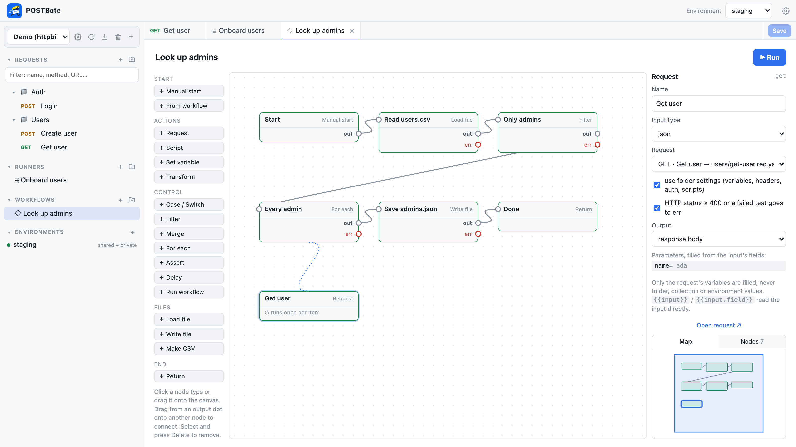
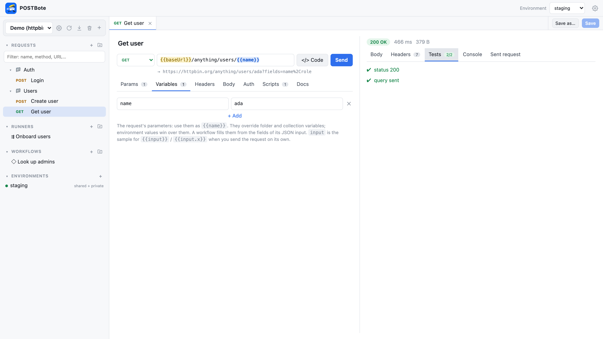
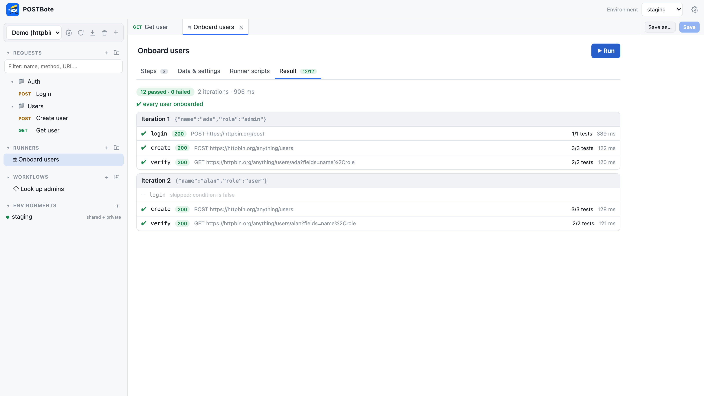

<p align="center">
  
</p>

<h1 align="center">POSTBote</h1>

<p align="center">
  <b>The offline-first API client.</b> No cloud, no account, no telemetry.<br>
  Collections, environments, runners and workflows are plain text files you version with git.
</p>

<p align="center">
  <a href="https://github.com/kaibrockelt/POSTbote/releases/latest"></a>
  <a href="https://github.com/kaibrockelt/POSTbote/actions/workflows/ci.yml"></a>
  <a href="#license"></a>
</p>

<p align="center">
  <a href="#download">Download</a> ·
  <a href="#features">Features</a> ·
  <a href="docs/collection-format.md">Collection format</a> ·
  <a href="docs/scripting.md">Scripting</a> ·
  <a href="docs/workflows.md">Workflows</a>
</p>

<picture>
  <source media="(prefers-color-scheme: dark)" srcset="docs/screenshots/workflow-dark.png">
  
</picture>

POSTBote is an API client in the spirit of Postman and Bruno, built for digital sovereignty. Your
collections live in a folder on your disk (or in your browser), secrets stay in gitignored files, and
nothing ever leaves your machine unless you send it.

## Features

- **Plain text, git-friendly:** one YAML file per request, folders as folders, small diffs. Opening a
  file never rewrites it.
- **Environments without leaks:** shared values in `<name>.env.pub` (committed), secrets in
  `<name>.env` (gitignored) — same names, private wins.
- **Variables that make sense:** collection, folder and request variables, environments, runtime
  values from scripts; `{{vars}}` highlighted with their source and value.
- **Tests and scripts in JavaScript** (ES2023, sandboxed QuickJS): `test()`/`expect()`, `vars`, `env`,
  files, CSV, `postbote.sendRequest` — before and after every request, folder and runner.
- **Runners:** chain requests over CSV/JSON data rows, with conditions, `goto` and `stop`.
- **Workflows:** node-based flows on a canvas — requests as functions, JavaScript, switch, filter, loops,
  files, sub-workflows.
- **Import everything:** paste cURL or raw HTTP; import Postman, OpenAPI 3 / Swagger 2, Bruno, `.http`
  (JetBrains/VS Code) and HAR. Secrets move into private environment values automatically.
- **Runs anywhere:** native desktop app (Tauri, no Electron), local mode in your browser, a multi-user
  team server in Docker, and a CLI for CI pipelines.
- **No CORS headaches:** requests are sent by the Rust backend, with cookies per environment.

<table>
  <tr>
    <td width="50%">
      <picture>
        <source media="(prefers-color-scheme: dark)" srcset="docs/screenshots/request-dark.png">
        
      </picture>
      <p align="center"><b>Requests</b> — variables, tests and the resolved URL at a glance</p>
    </td>
    <td width="50%">
      <picture>
        <source media="(prefers-color-scheme: dark)" srcset="docs/screenshots/runner-dark.png">
        
      </picture>
      <p align="center"><b>Runners</b> — request chains over data rows</p>
    </td>
  </tr>
</table>

## Download

<!-- download links: updated by scripts/bump-version.sh -->
Latest release: **[v0.3.0](https://github.com/kaibrockelt/POSTbote/releases/tag/v0.3.0)** ([all releases](https://github.com/kaibrockelt/POSTbote/releases))

| Platform | Desktop app | CLI / server |
| --- | --- | --- |
| macOS (universal) | [.dmg](https://github.com/kaibrockelt/POSTbote/releases/download/v0.3.0/POSTBote_0.3.0_universal.dmg) | [.tar.gz](https://github.com/kaibrockelt/POSTbote/releases/download/v0.3.0/postbote-v0.3.0-macos-universal.tar.gz) |
| Windows (x64) | [Installer (.exe)](https://github.com/kaibrockelt/POSTbote/releases/download/v0.3.0/POSTBote_0.3.0_x64-setup.exe) · [MSI](https://github.com/kaibrockelt/POSTbote/releases/download/v0.3.0/POSTBote_0.3.0_x64_en-US.msi) | [.zip](https://github.com/kaibrockelt/POSTbote/releases/download/v0.3.0/postbote-v0.3.0-windows-x86_64.zip) |
| Linux (x86_64) | [AppImage](https://github.com/kaibrockelt/POSTbote/releases/download/v0.3.0/POSTBote_0.3.0_amd64.AppImage) · [.deb](https://github.com/kaibrockelt/POSTbote/releases/download/v0.3.0/POSTBote_0.3.0_amd64.deb) · [.rpm](https://github.com/kaibrockelt/POSTbote/releases/download/v0.3.0/POSTBote-0.3.0-1.x86_64.rpm) | [.tar.gz](https://github.com/kaibrockelt/POSTbote/releases/download/v0.3.0/postbote-v0.3.0-linux-x86_64.tar.gz) |
| Linux (arm64) | – | [.tar.gz](https://github.com/kaibrockelt/POSTbote/releases/download/v0.3.0/postbote-v0.3.0-linux-arm64.tar.gz) |
| Docker (amd64 + arm64) | – | `ghcr.io/kaibrockelt/postbote` |
<!-- /download links -->

The builds are not signed yet. On macOS, right-click the app and choose **Open** the first time (or run
`xattr -dr com.apple.quarantine /Applications/POSTBote.app`); on Windows, choose **More info → Run
anyway** in SmartScreen. Linux needs WebKitGTK (`libwebkit2gtk-4.1`), Windows the WebView2 runtime
(preinstalled on Windows 10/11).

## Run it

### Desktop app

Install it from [Download](#download), or build it yourself:

```bash
cd web && npm ci && npm run build && cd ..
cargo run --release -p postbote-desktop
```

On first start a short wizard asks where your collections live – by default
`~/Documents/POSTBote` (the platform's documents folder on Windows/Linux). Every collection is one
folder in there and shows up automatically; folders elsewhere (e.g. inside a project repository) can
be added as well. The choice is stored in the user config directory (`postbote/config.json`) and can be
changed later in Settings (gear icon in the top bar).

Installers for macOS/Windows/Linux are built with the Tauri CLI (`cargo install tauri-cli`,
then `cargo tauri build` inside `desktop/`).

### Local mode in your browser (no webview needed)

```bash
postbote local                                  # CLI binary from the release
cargo run --release -p postbote-server -- local # or from source
```

Starts on `127.0.0.1` with a random port and opens your browser with a one-time access token. Same
features and collections folder as the desktop app.

### Team server (Docker)

```bash
docker compose up -d
docker compose run --rm postbote user add alice
```

Open `http://localhost:8080` and sign in. Users and passwords (bcrypt) live in `/data/users.json` and are
managed with `postbote user add|remove|list`; running `user add` for an existing user sets a new password.
Users can change their own password and sign out under Settings. Sessions are signed cookies valid for
14 days and tied to the password: changing it or removing the user ends all sessions of that user. After
5 failed sign-ins for a user name (20 per address) further attempts are locked for 30 s, doubling up to
15 min. Serve it via HTTPS (reverse proxy) and set `POSTBOTE_SECURE_COOKIES=true`. With
`POSTBOTE_AUTH=header` your sign-in proxy (oauth2-proxy, Authelia, …) authenticates users instead; then
only the proxy may reach the container.

Every user is isolated. By default a user's collections (including
environments) are stored **in their browser only** (IndexedDB) and can be exported/imported as zip.
Storing a collection on the server is an explicit opt-in per collection, and the admin can disable it
altogether (`POSTBOTE_NO_SERVER_STORAGE=true`). For browser-stored collections the server only receives
the files for the duration of a run and keeps nothing.

| Variable | Default | Meaning |
| --- | --- | --- |
| `POSTBOTE_ADDR` | `0.0.0.0:8080` | listen address |
| `POSTBOTE_DATA` | `/data` | users, session key, opt-in collections |
| `POSTBOTE_AUTH` | `local` | `local` (users via `postbote user add`), `header` (behind an auth proxy such as oauth2-proxy/Authelia), `none` |
| `POSTBOTE_AUTH_HEADER` | `X-Forwarded-User` | user header for `header` mode — only expose POSTBote through the proxy |
| `POSTBOTE_NO_SERVER_STORAGE` | `false` | disable opt-in server storage |
| `POSTBOTE_DENY_PRIVATE_NETWORKS` | `false` | block requests to private/loopback/link-local addresses (SSRF protection) |
| `POSTBOTE_MAX_RUN_SECONDS` | `600` | maximum duration of one run |
| `POSTBOTE_SCRIPT_MEMORY_MB` | `128` | memory limit of the script engine per run |
| `POSTBOTE_MAX_CONCURRENT_RUNS` | `32` | parallel runs |
| `POSTBOTE_SECURE_COOKIES` | `false` | set when served via HTTPS |

### CLI / CI

```bash
postbote run path/to/collection requests/users/get-user.req.yaml --env staging
postbote run path/to/collection runners/onboarding.runner.yaml --env staging --json
```

Exit code `1` when a request fails, a script throws or a test fails.

Try the bundled example: `postbote run examples/demo runners/onboarding.runner.yaml --env staging`.

## Collection format

A collection is a folder ([details](docs/collection-format.md)):

```text
my-api/
├── postbote.yaml                         # name, settings, variables, headers, auth, scripts
├── .gitignore                        # managed block: *.env and .cookies/ stay local
├── environments/
│   ├── staging.env.pub               # shared values of "staging" (committed)
│   └── staging.env                   # private overrides/secrets of "staging" (gitignored)
├── requests/
│   └── users/
│       ├── _folder.yaml              # folder headers / variables / auth / scripts
│       └── get-user.req.yaml
├── runners/
│   └── onboarding.runner.yaml
└── data/users.csv                    # any text file, usable from scripts and runners
```

```yaml
# requests/users/get-user.req.yaml
name: Get user
method: GET
url: "{{baseUrl}}/users/{{userId}}"
headers:
  - key: Accept
    value: application/json
scripts:
  post: |
    test('status 200', () => expect(res.status).toBe(200));
    vars.set('userName', res.json().name);
```

Shared and private files of the same name form one environment; private values win. Exports leave
environments out unless chosen, and private values need an extra opt-in. Whether private files are
committed after all is a collection setting (`settings.commitEnvironments`), which rewrites only
POSTBote's block in `.gitignore`.

## Scripting

Scripts are JavaScript (ES2023, QuickJS) with `req`, `res`, `test`/`expect`, `env`, `vars`, `fs`, `csv`,
`util`, `postbote.sendRequest` and `wf`. See [docs/scripting.md](docs/scripting.md).

## Architecture

```text
crates/postbote-core     collection format, dotenv, runner (reqwest), scripting (rquickjs)
crates/postbote-server   axum API + embedded web UI; `postbote` binary (local | serve | run | user)
desktop/             Tauri shell: runs the local server in-process, shows it in the system webview
web/                 Svelte 5 UI (≈75 KB gzipped)
```

All requests are executed by the Rust backend (no CORS restrictions, scripts run sandboxed with time
and memory limits). The UI talks to the backend over a small JSON API.

Security model:

- **Local/desktop:** the server binds to `127.0.0.1` only and requires a random per-start token
  (exchanged for an `HttpOnly`, `SameSite=Strict` cookie). Mutating API calls require an `X-Postbote`
  header, so other websites cannot drive the API (no CORS is ever allowed).
- **Scripts** only see the files of their own collection (paths are sandboxed, symlinks out of the
  collection are rejected) and have no network access other than `postbote.sendRequest`.
- **Team server:** bcrypt-hashed users or an auth proxy, signed session cookies tied to the password,
  a limit for failed sign-ins, per-user storage,
  optional SSRF protection, run/memory/concurrency limits.

## Releases

Pushing a version tag builds everything on GitHub Actions and creates a **draft release**:

```bash
scripts/bump-version.sh 0.2.0
git commit -am "Release 0.2.0" && git tag -a v0.2.0 -m v0.2.0 && git push --follow-tags
```

The script also points the [download links](#download) in this README at the new version.

- Desktop app: macOS `.dmg` (universal), Windows `.exe`/`.msi`, Linux `.AppImage`/`.deb`/`.rpm`
- `postbote` CLI/server binaries for macOS, Windows and Linux (static, x86_64 + arm64)
- Docker image `ghcr.io/kaibrockelt/postbote` (amd64 + arm64)

Builds are unsigned by default (macOS ad-hoc signed). For notarized macOS builds add the Apple
secrets listed in [`.github/workflows/release.yml`](.github/workflows/release.yml) and set the
repository variable `MACOS_SIGNING=true`. Icons are generated from `desktop/icons/src/glyph.svg`
with `npm run icons` in `web/`.

## Development

```bash
cargo test                                  # core + server tests
cargo run -p postbote-server -- serve --addr 127.0.0.1:8080 --auth none --data ./data
cd web && npm run dev                       # UI with hot reload, proxies /api to :8080
```

## Contributing

Contributions are welcome — see [CONTRIBUTING.md](CONTRIBUTING.md). Please follow the
[Code of Conduct](CODE_OF_CONDUCT.md) and report security issues privately ([SECURITY.md](SECURITY.md)).

## License

Licensed under either of

- Apache License, Version 2.0 ([LICENSE-APACHE](LICENSE-APACHE))
- MIT license ([LICENSE-MIT](LICENSE-MIT))

at your option. Unless you explicitly state otherwise, any contribution intentionally submitted
for inclusion in POSTBote by you, as defined in the Apache-2.0 license, shall be dual licensed as
above, without any additional terms or conditions.
